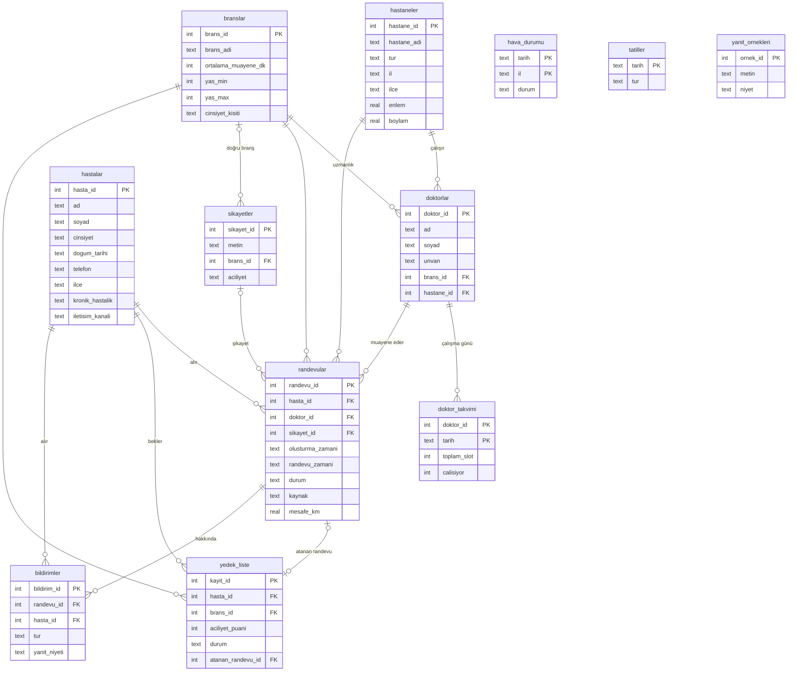

# ER Diyagramı (Şema v0)

GitHub bu diyagramı otomatik çizer.

`hava_durumu` ve `tatiller` tablolarına yabancı anahtar ile değil, **tarih** (ve il) üzerinden bağlanılır.
Bu bağlantıyı `v_noshow_ozellikleri` görünümü yapar.
