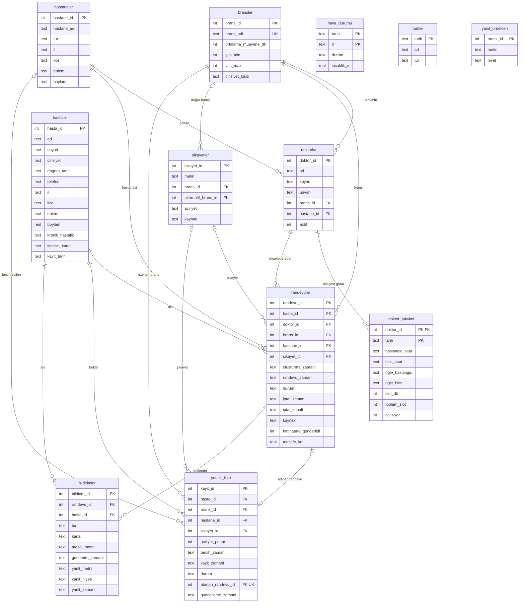

# ER Diyagramı (Şema v1.0)

GitHub bu diyagramı otomatik çizer. Tüm sütunlar gösterilir; kurallar ve açıklamalar için
[veri sözlüğüne](../docs/veri_sozlugu.md) bakın.

`sikayetler.alternatif_brans_id` de `branslar` tablosuna bağlıdır (diyagramı sade tutmak için çizilmedi).
`hava_durumu` ve `tatiller` tablolarına yabancı anahtar ile değil, **tarih** (ve hastanenin ili) üzerinden bağlanılır;
bu bağlantıyı `v_noshow_ozellikleri` görünümü yapar. `yanit_ornekleri` bağımsız bir eğitim korpusudur.

## Görünümler

| Görünüm | Kaynak tablolar | Kimin için |
|---|---|---|
| `v_triyaj_veri` | sikayetler, branslar | 2. grup (Triyaj) |
| `v_noshow_ozellikleri` | randevular, hastalar, hastaneler, hava_durumu, tatiller | 3. grup (No-Show) |
| `v_bekleyen_randevular` | randevular, hastalar, branslar, doktorlar, hastaneler | 4. grup (Chatbot) |
| `v_bekleyen_yedek` | yedek_liste, hastalar | 5. grup (Yedek Liste) |
| `v_aylik_ozet`, `v_aylik_brans_ozet`, `v_doluluk` | randevular, hastaneler, branslar, doktor_takvimi | 6. grup (Dashboard) |
